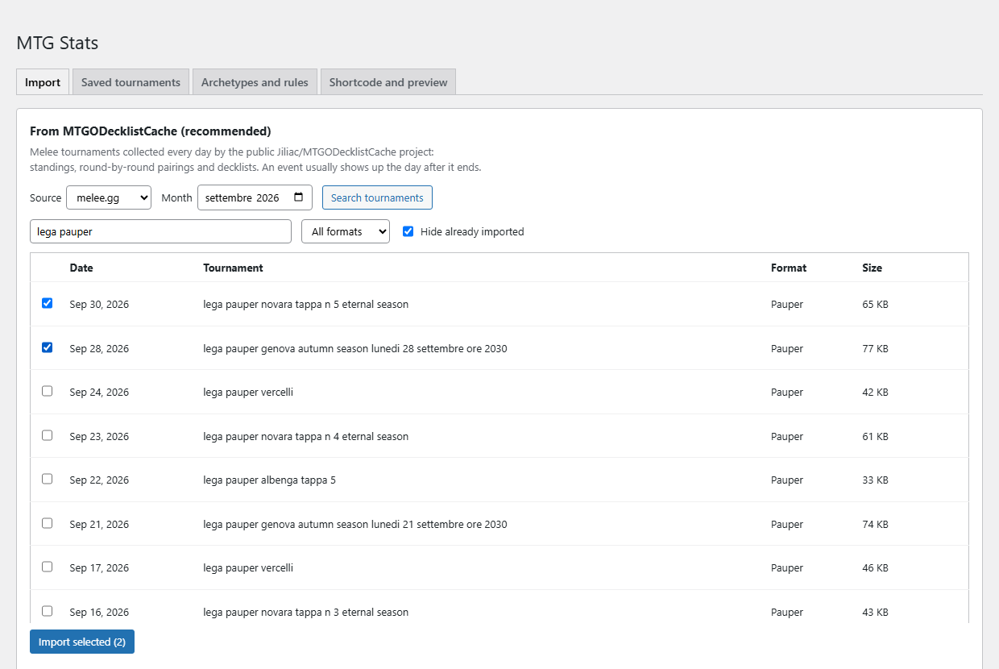
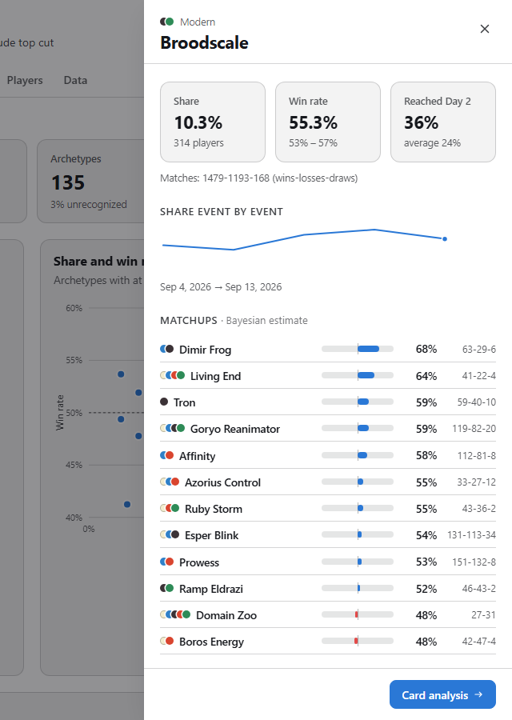
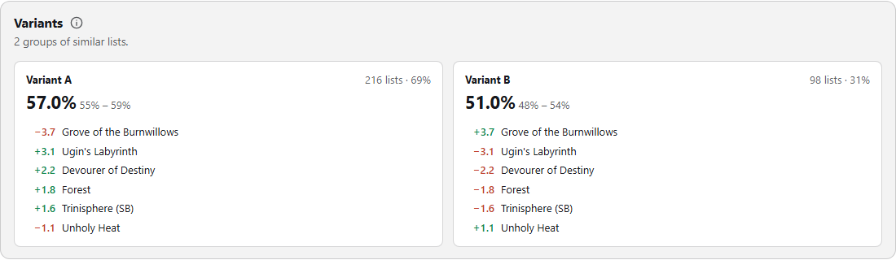

# User guide

This guide covers day-to-day use of the plugin: importing tournaments, checking archetypes and publishing the
dashboard.

The interface is in English or Italian, following the language of the WordPress site; on an Italian site, every
label in this guide appears in Italian. Labels are quoted here in English.

- [Two sides of the plugin](#two-sides-of-the-plugin)
- [Installing](#installing)
- [Importing tournaments](#importing-tournaments)
- [Reviewing archetypes](#reviewing-archetypes)
- [House rules and aliases](#house-rules-and-aliases)
- [Managing saved tournaments](#managing-saved-tournaments)
- [Deck focus](#deck-focus)
- [Publishing the dashboard](#publishing-the-dashboard)
- [Reading the dashboard](#reading-the-dashboard)
- [Exporting data](#exporting-data)
- [Troubleshooting](#troubleshooting)

## Two sides of the plugin

| | Who uses it | Where | Purpose |
|---|---|---|---|
| **Admin panel** | site administrators | WordPress admin → **MTG Stats** | choose which events to import, check archetypes |
| **Dashboard** | site visitors | any page containing `[mtgstats]` | charts and statistics |

Importing runs in the administrator's browser. Keep the admin page open until the log shows **saved ✓** for every
event. To import new events every night without opening the admin, see
[Automatically, every night](#automatically-every-night).

## Installing

1. Go to **Plugins → Add New → Upload Plugin**, select `mtgstats-1.26.3.zip`, then click **Install Now** and **Activate**.
2. A new **MTG Stats** entry appears in the admin menu.
3. Tournament data is stored in `wp-content/uploads/mtgstats/`, so uninstalling the plugin does not delete it.

To upgrade, upload the new zip the same way and confirm that you want to replace the installed version. Imported
tournaments stay compatible.

## Importing tournaments

Open **MTG Stats → Import**.



### From the cache (recommended)

The **From MTGODecklistCache** panel lists events collected every day by the public
[MTGODecklistCache](https://github.com/Jiliac/MTGODecklistCache) project. MTGO events come from its
[fbettega/MTG_decklistcache](https://github.com/fbettega/MTG_decklistcache) fork, the only one that still collects
them. Each event comes with standings, pairings for every round and all decklists. New events usually appear the day
after they end.

| Source | What it contains |
|---|---|
| `melee.gg` | Standings, pairings for every round, decklists |
| `mtgo.com` | **Challenges**: standings with full records, top 8 pairings only, decklists. **Leagues**: 5-0 decklists only, so their win rates are inflated |
| `CardsRealm` | Local events, mostly from Brazil |
| `topdeck.gg`, `manatraders.com` | Archives: no longer updated (until April 2025 and November 2024) |

1. Choose the **Source** (usually `melee.gg`) and the **Month**.
2. Click **Search tournaments**.
3. Narrow the list with the text filter, the format menu and **Hide already imported**.
4. Tick the events you want, or use the checkbox in the table header to select every event in the list, then click
   **Import selected**.

The format is read from the source and refined by the event name: a "Duel Commander" or "Centurion" event filed as
Commander, or a "Premodern" event, gets its own format.

For each event, the log shows the player count, the detected format and how the archetypes were assigned. The first
import of a format also downloads its archetype rules, which takes a few seconds. The rules are then cached on the
server for 7 days.

### Automatically, every night

The repository includes a GitHub Actions workflow, [`.github/workflows/sync.yml`](../.github/workflows/sync.yml). It
runs the headless importer [`tools/sync.js`](../tools/sync.js) every day at 06:30 UTC, and again at 18:45 UTC to catch up when GitHub skips a run. The importer does what
**Import selected** does, with your house rules and aliases, and saves the events through the plugin's REST API.

1. In WordPress, open **Users → Profile → Application Passwords**, type a name such as `MTG Stats sync`, click
   **Add New Application Password** and copy the password. The user must be an administrator.
2. In your copy of the repository on GitHub, open **Settings → Secrets and variables → Actions** and add:
   - variable `MTGSTATS_URL`: the site address, for example `https://example.com`;
   - secret `MTGSTATS_USER`: the WordPress user name;
   - secret `MTGSTATS_APP_PASSWORD`: the password from step 1.
3. Optionally, add these variables:

   | Variable | Default | Effect |
   |---|---|---|
   | `MTGSTATS_FORMATS` | `Modern` | formats to import, comma separated |
   | `MTGSTATS_SOURCES` | `melee.gg,mtgo.com` | cache sources |
   | `MTGSTATS_DAYS` | `30` | how many days back to look |
   | `MTGSTATS_MAX` | `40` | maximum number of events per run; the rest waits for the next run |
   | `MTGSTATS_LEAGUES` | `0` | `1` also imports MTGO Leagues, which only publish 5-0 lists |
   | `MTGSTATS_REST` | `<site>/wp-json/mtgstats/v1` | REST address, for sites without pretty permalinks: `<site>/?rest_route=/mtgstats/v1` |

4. Open **Actions → Sync tournaments → Run workflow**. Tick *dry run* the first time: the log lists what would be
   imported, without saving anything. GitHub starts the scheduled runs only once the workflow is on the repository's
   default branch. Scheduled runs are not guaranteed: in the first days, or when GitHub is busy, they can be late
   or skipped. The evening run catches up, and you can always start one by hand.

Leagues are left out by default. Their 5-0 lists would inflate every win rate on the Metagame, Matchups and
Positioning tabs. The deck focus tab handles them separately (see [Deck focus](#deck-focus)), so import them only if
you want more lists for that tab.

The importer also runs from any computer with Node 18 or later:

```bash
MTGSTATS_URL=https://example.com MTGSTATS_USER=admin MTGSTATS_APP_PASSWORD="xxxx xxxx xxxx xxxx" node tools/sync.js
```

### Directly from Melee

Use the **Directly from Melee** panel for events that are not in the cache yet.

1. Paste the tournament URL, for example `https://melee.gg/Tournament/View/123456`, or just its ID.
2. Keep **Also download decklists** ticked to get archetype detection and card statistics. Without decklists,
   archetypes come from the deck names declared by the players.
3. Click **Import from Melee**.

Requests go through your WordPress server, because melee.gg does not allow cross-origin browser requests. With
decklists, a large event (about 1,000 players) takes a few minutes. Rounds played in a format other than the main
one, such as Pro Tour draft rounds, are flagged and excluded from all statistics.

## Reviewing archetypes

After an import, the **Imported** panel shows how many decks were not recognized. Click **Review** on a tournament.
The review page can also be reached later from **Saved tournaments**.

On the review page you can:
- **edit the event details**: name, date, format;
- **include or exclude rounds** from the statistics, for example draft or invalid rounds;
- **rename an archetype for the whole event**: select it, type the new name and click **Rename**;
- **fix individual players.** The list shows **To check** by default: unrecognized decks, conflicts, and decks
  matched only by similarity. Click **List** to see the decklist, then type the correct archetype. Existing names
  are suggested as you type.

Click **Save changes** when done. Manual fixes are marked as *manual* and re-classification never overwrites them.

The **Method** column shows how each deck was classified:

| Badge | Meaning |
|---|---|
| house rule | matched one of your house rules |
| rule | matched a community rule |
| variant | matched a rule and one of its variants |
| supplementary | matched a supplementary rule shipped with the plugin (see below) |
| similarity | no rule matched; closest generic archetype ("fallback"), e.g. *Dimir Midrange* |
| conflict | several rules matched; the simplest was chosen (configurable) |
| unrecognized | nothing matched |
| no list | no decklist available; the declared deck name is used if present |
| declared | the format has no community rules and no house rule matched; the declared deck name is used |
| manual | set by hand |

## House rules and aliases

**Archetypes and rules** holds fixes that apply to every event. A deck is checked against four sets of rules, in
this order:

1. **House rules**: your own definitions, saved in the WordPress database;
2. **community rules** from [MTGOFormatData](https://github.com/Badaro/MTGOFormatData);
3. **supplementary rules** shipped with the plugin, for recent archetypes the community rules do not cover yet
   (for example *Jund Sacrifice* and *Boros Dwarves* in Standard). They only apply when no community rule matches;
4. **similarity groups** ("fallbacks"), when no rule matches at all.

### Archetype catalog

The **Archetype catalog** lists everything the plugin recognizes in a format, with the source of each archetype and
its definition in plain words. Search by archetype or card name. The header shows when the community rules were
downloaded; **Update community rules now** downloads them again (otherwise they refresh every 7 days).

**Customize** copies a community or supplementary archetype into a new house rule. A house rule with the same name
as a community archetype replaces it.

### Writing a house rule

Click **New rule** (or **Customize** in the catalog) to open the editor:

- **Archetype name**: written as you want it displayed, e.g. *Boros Dwarves*.
- **Format**: limits the rule to one format; *All formats* applies it everywhere.
- **Put the deck colors before the name**: with *Aggro*, an Izzet deck becomes *Izzet Aggro*.
- **Conditions**: a deck gets the archetype when it meets **every** condition. Each condition is a type plus a list
  of cards:

| Type | Meaning |
|---|---|
| Main deck: all of | every listed card is in the main deck |
| Main deck: at least one of / at least two of | that many of the listed cards are in the main deck |
| Main deck: none of | none of the listed cards is in the main deck |

  The same types exist for the sideboard and for main deck or sideboard. Type a card name and pick it from the
  Scryfall suggestions, or paste a list with one card per line. Names are checked on Scryfall: a red card is unknown,
  a yellow one has a suggested spelling (click it to fix). Capitals, accents and the back face of double-faced cards
  do not matter.

**Test on saved tournaments** runs the rule alone on your 25 most recent saved tournaments of that format and shows
how many decks it takes and how they are classified now. **Save rule** stores it.

The **House rules** list shows every rule with its format, definition and status:
- **active**: used for classification;
- **off**: kept but not used (untick the checkbox to switch a rule off);
- **ignored: errors**: the rule is saved but has a problem, which is shown under its name. Fix it with **Edit**.

**Import JSON files…** adds rules in the MTGOFormatData schema, for example archetype files from that repository; a
rule without a `Format` gets the format chosen in **Show**. **Download JSON** saves a backup. **Edit all house rules
as JSON** opens every rule as text, which is also where variants can be changed:

```json
[
  {
    "Name": "Devoted Combo",
    "Format": "Modern",
    "IncludeColorInName": false,
    "Conditions": [
      { "Type": "InMainboard", "Cards": ["Devoted Druid"] },
      { "Type": "OneOrMoreInMainboard", "Cards": ["Vizier of Remedies", "Luxior, Giada's Gift"] }
    ]
  }
]
```

`Disabled: true` switches a rule off. The condition types are listed in the [methodology](methodology.md#rules).

After every change, a notice offers to **reclassify the saved tournaments**. Imported events keep their archetypes
until then; manual fixes are never overwritten.

### Aliases

**Aliases**, one per line, as `Detected name => Displayed name`:

```
Simic Birthing Ritual => Simic Ritual
Neobrand => Simic Neoform
```

### Options

- **Conflict handling**: pick the simplest matching rule (default), or label the deck `Conflict(A,B)`.
- **Bayesian win-rate prior**: the strength of the Beta(prior, prior) prior used for win-rate smoothing. The default
  is 10; 1 means almost no smoothing.
- **Custom accent color**: the color of bars, lines and active controls. When it is off, the dashboard uses the
  WordPress theme's primary color, if the theme declares one, or a neutral blue.

Click **Save aliases and options** to store them.

## Managing saved tournaments

**Saved tournaments** lists every stored event with its number of unrecognized decks. Filter it by name or format,
tick events (the header checkbox selects every visible one), then:
- **Reclassify selected**: runs detection again with the current rules and aliases, keeping manual fixes;
- **Delete selected**: removes the event files from the site. This cannot be undone.

**Review** opens an event's review page.

## Deck focus

A deck focus follows one deck closely. Take Omnath in Modern as an example. The community rules split its lists
between several archetypes; a focus gathers every list that plays Omnath, then splits them into the versions you
define, for instance *Ritual* (Birthing Ritual), *Paradox / W6* (Way of the Paradox or Wrenn and Six) and
*Elementals* (Risen Reef).

**Setting it up.** Open **MTG Stats → Deck focus**.

1. Click **New focus**, or **Add preset: Omnath (Modern)** to start from the definition above.
2. Fill in:
   - **Deck name**: shown as the tab name;
   - **Format**;
   - **Key cards**: a list belongs to the deck when its main deck plays at least one of them.
3. Add the **versions**. Each version is a rule with the same conditions as house rules, edited in the same editor.
   Versions are tried in order and the first match wins, so put the most specific ones first with the ↑ ↓ buttons.
4. Click **Test on saved tournaments**. You see how many lists each version takes, and how the plugin classifies them
   today.
5. Click **Save focus**, then add its shortcode to a page, for example `[mtgstats focus="omnath"]`.

Lists that meet no version are shown as *other lists*. When enough of them look alike, the dashboard shows the group
and its signature cards: a hint that a new version has appeared.

**Reading the focus tab.**
- **Which version to play.** Each version's expected win rate against the field you choose (whole selection, Day 2,
  Top 8, latest event), with the probability that it is the best choice. The recommendation above the chart warns
  when the versions are close or the matches are few. Versions with fewer than 20 matches are left out of the
  comparison; when only one version is left, the tab says so and shows no probability.
- **Best version by matchup.** For each of the most played archetypes, the estimated win rate of every version. The
  outlined cell is the best version against that deck: useful to pick a version for a known local metagame.
- **Version details.** Pick a version to see:
  - its average list, ready to copy;
  - *What is changing*: the cards gaining or losing ground in the last 21 days, with new ones marked;
  - its variants and card impact;
  - its best results.
- **Versions over time.** Each version's share of the deck's lists, week by week.

MTGO League events, which only publish 5-0 lists, count for the lists and for *Versions over time*, but not for win
rates, shares and matchups.

## Publishing the dashboard

Add a **Shortcode** block containing `[mtgstats]` to any page or post. Available attributes:

| Attribute | Example | Effect |
|---|---|---|
| `format` | `format="Pauper"` | initial format |
| `days` | `days="60"` | initial period (`7`, `30`, `90`, any number of days, `all`) |
| `tournaments` | `tournaments="melee-gg-405590-2026-09-05"` | fixed selection; hides the format, period and event pickers |
| `tabs` | `tabs="meta,mu,pos"` | show only some tabs: `focus, meta, mu, pos, trend, conv, cards, players, data` |
| `focus` | `focus="omnath"` | adds the tab of a [deck focus](#deck-focus), first in line, and starts on its format |
| `theme` | `theme="dark"` | `auto` (default) follows the page background; `light` and `dark` force a theme |
| `accent` | `accent="#c2412d"` | accent color for this page; overrides the setting and the theme color |
| `prior` | `prior="5"` | smoothing prior for this page |
| `lang` | `lang="en"` | `en` or `it`; by default, the site language |

Tournament IDs appear in the file names under `uploads/mtgstats/t/`. They look like `<source>-<event id>-<date>`.

To write an article about a single event, use the `tournaments` attribute; visitors then cannot change the
selection.

The dashboard adapts to the page it lives on:
- it uses the theme's font and text color;
- it detects whether the page background is light or dark;
- its accent color comes from the `accent` attribute, then the plugin setting, then the theme's primary color
  (block themes expose it as `--wp--preset--color--primary`);
- the filter bar stays visible while scrolling, below the WordPress admin bar when you are logged in.

**Shortcode and preview** in the admin panel shows a live preview of the dashboard.

## Reading the dashboard

**Filters.** The bar at the top stays visible while scrolling. It holds:
- the format;
- the period: 7 days, 30 days, 90 days or everything, counted back from the most recent event;
- the event picker, with search;
- the **Exclude top cut** switch, which drops playoff rounds.

Active filters show up as chips under the bar; click a chip to remove its filter.

**Sharing.** The current view is kept in the page address: tab, format, period, events, top-cut switch and open
archetype. **Copy link** copies it, and whoever opens the link sees the same view.

**Archetype profile.** Click an archetype anywhere to open its profile in a side panel (a bottom sheet on phones):
a bar, a dot, a table row, a matrix header or a panel title in Trends. The profile shows:
- share, smoothed win rate and conversion;
- share event by event;
- every matchup, with Bayesian estimate and record;
- variants and the average list;
- the best results.

**Card analysis** opens the full Cards tab. Press Esc or click outside the panel to close it.



**Shared conventions**
- **Smoothed win rate.** Matches are shrunk toward 50% with a Beta prior, so archetypes with few matches do not top
  the rankings. The raw win rate is always shown next to it.
- **Intervals.** The dot is the estimate and the line the uncertainty: 95% for win rates, 90% for matchups and
  expected win rates.
- **Explanations.** Each section has a one-line description. The ⓘ button next to the title opens the full
  explanation of how to read it.
- **Tooltips.** Hover, tap or focus any bar, dot or cell to see the raw counts.
- **Keyboard.** Arrow keys move between tabs, Tab moves through chart rows, Enter opens the profile.

**Tab by tab**
- **Deck focus** (when the shortcode has `focus`): see [Deck focus](#deck-focus).
- **Matchups.** Switch between *Observed* and *Estimated*. A small dot in a cell marks a clear-cut matchup, where the
  favorite is favored with at least 95% probability.
- **Positioning.**
  - *Expected win rate*: the win rate to expect when bringing each deck against the chosen field. The tick shows
    the win rate observed so far.
  - *Equilibrium metagame*: the deck mix that the matchup matrix rewards. Read it as a theoretical indicator, not a
    forecast.
- **Trends.** The small charts share one vertical scale, so panels can be compared directly. The change shown is
  the last period minus the first.
- **Cards.**
  - *Average list*: can be copied into MTGO or Arena.
  - *Variants*: groups of similar lists, each with its own win rate.
  - *Card impact*: a correlation, not a causal effect. A card often just marks a variant.

  
- **Players.**
  - *Estimated strength*: the probability of beating an average player with the same deck.
  - *Deck or pilot?*: each archetype's win rate with pilot skill factored out.

The [methodology](methodology.md) explains every number in detail.

## Exporting data

The **Data** tab offers three CSV files per event:

| File | Columns |
|---|---|
| Standings | `Rank, Player, Deck, W, L, D, Winrate, Points` |
| Matches | `Round, Table, Player1, Player2, Deck1, Deck2, Games1, Games2, GameDraws` |
| Decklists | `Player, Deck, Section, Card, Qty` |

The **Metagame** tab also exports the full archetype table. Files are UTF-8 with a BOM, so Excel opens them correctly.

## Troubleshooting

| Symptom | Cause / fix |
|---|---|
| "GitHub request limit reached" | GitHub allows 60 anonymous API calls per hour per IP. A month search uses 2 and each new format 1. Wait, then try again. |
| Many *unrecognized* decks in a fresh format | A new set introduced archetypes that the community rules do not cover yet. Add a house rule (test it first) or fix the decks by hand. |
| A house rule does not match anything | Check its status in the **House rules** list and the card names in the editor (red = unknown card). Remember that every condition must be met. |
| Odd color names such as *WBRG Ponza* | Colors count both lands and spells, sideboard included, as in the original parser. Use an alias. |
| Wrong rules for an old Standard event | Rules are cached per format. Use *Reload community rules on the next import*, then reclassify. |
| The dashboard still looks like an older version after an update | Asset URLs change on every update, so this usually means a page cache. Clear your caching plugin or CDN cache once, then reload with Ctrl+F5. |
| The dashboard is dark on a light site | Your theme probably paints its background on an element that does not contain the shortcode. Add `theme="light"` to the shortcode. |
| Dashboard colors clash with the site | Set *Custom accent color* in the options, or `accent="#…"` in the shortcode. If the page background is an image or a gradient, set `theme="light"` or `theme="dark"`. |
| Wrong interface language | The language follows the WordPress site language. Force it with `lang="en"` or `lang="it"`. |
| Direct Melee import fails | Check that the event is public and that your server can reach `melee.gg`. If Melee changed its site, the importer needs updating; please open an issue. |
| The scheduled import fails with HTTP 401 | Check the user name and the Application Password. Some hosts strip the `Authorization` header before PHP sees it: ask the host, or add `SetEnvIf Authorization "(.*)" HTTP_AUTHORIZATION=$1` to `.htaccess`. |
| The scheduled import finds no events | Check `MTGSTATS_FORMATS` and `MTGSTATS_DAYS`. Run the workflow with *dry run* to see what it considers. |
| The focus tab does not appear | The `focus` attribute must match the id in the **Deck focus** list (shown in its shortcode). |
| A version shows no win rate | Its lists come only from MTGO Leagues, or it has fewer than 20 matches in the selection. Widen the period. |
| Dashboard shows "Data unavailable" | `wp-content/uploads/mtgstats/index.json` is missing or blocked. Open **MTG Stats** in the admin once to recreate the folder. |
